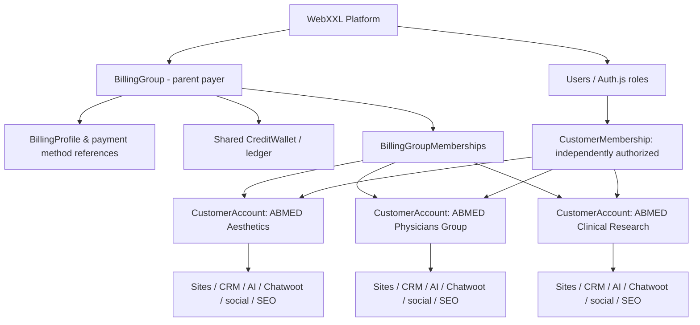
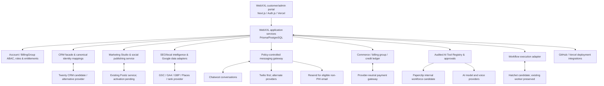
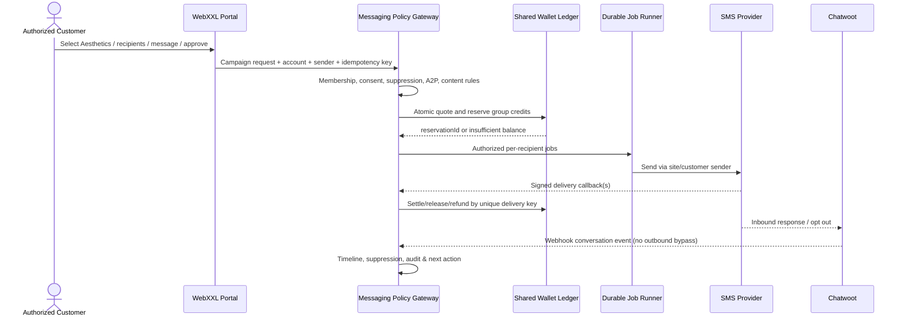
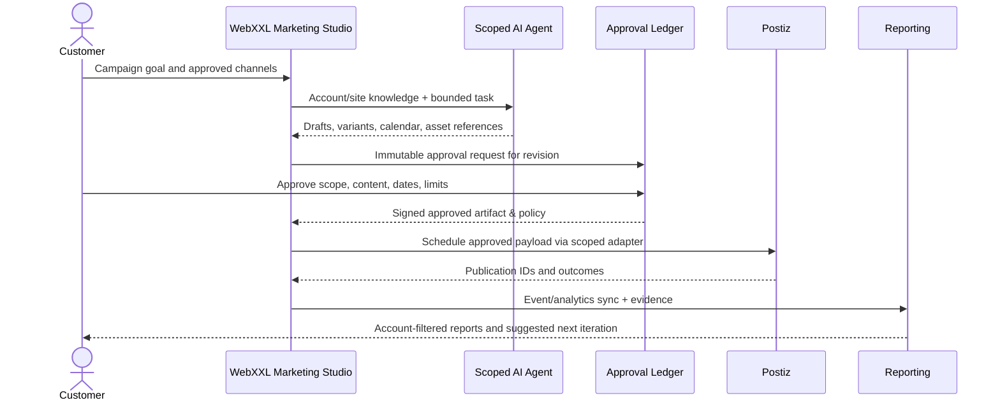

# 01 — WebXXL Technical Architecture Document (Master TAD)

**Doc ID:** WEBXXL-TAD-001 · **Version:** 1.0.0 · **Date:** 2026-10-17 · **Status:** OWNER-DIRECTED TARGET DESIGN, ISSUED FOR FINAL DOCUMENT REVIEW; NOT A DEPLOYMENT REPORT.  
**Domain:** WebXXL customer/admin portal, managed websites, CRM, communications, AI workforce, Marketing Studio, local intelligence, social publishing, commerce and billing.  
**Baseline:** `README.md`, `02-CURRENT-STATE.md` and the owner's screenshot of `https://www.webbxxl.com/dashboard`.  
**Implementation owner:** Cursor for backend, integrations, DB, tests and deployment logic; **v0.app for all public/customer/admin UI/UX**. Production WebXXL application remains on **Vercel**. Specialist self-hosted services can run on isolated Hostinger/Docker resources after capacity assessment.

## 1. Mission and architectural success condition

WebXXL sells website subscriptions, and provides an integrated **FREE** marketing operating system to eligible customers: robust CRM, AI marketing studio, local SEO/competitor intelligence, social automation (Postiz), AI page/ad-creative production and ordinary marketing agents. Revenue comes from website subscriptions, metered SMS, selected third-party provider services (domains, hosting, business email), and authorized third-party spend. Retain an optional later customer-purchased AI employee catalog behind feature flags **without compromising included free AI services**. Customer eligibility for free non-subscriber accounts is UNRESOLVED and configurable; do not assume a paid CRM tier.

Success means a parent operator managing ten businesses and websites can switch between ten distinct CRM spaces, ten AI receptionist configurations and ten social/SEO contexts while sharing an approved corporate billing wallet and payment relationship; every member sees only data it is allowed to see. One platform, no tenfold setup or top-ups.

## 2. Unalterable design invariants

- **Expandability without product downgrade:** modular components/flags, stable account-level identities, replaceable providers, additive migrations, explicit feature ownership, no removal of scoped capabilities without owner approval.
- **Tenant isolation:** a `CustomerAccount` is the primary operational isolation boundary for CRM, contacts, campaigns, inboxes, projects, AI knowledge, social connections, website assets, permissions and audit. `ManagedSite`/`WebsiteProject` are site/project boundaries within the account.
- **Separate billing aggregation:** `BillingGroup` is an explicit financial aggregation of one or more accounts, not proof of legal identity or permission to access sibling data.
- **One shared authorized wallet:** each group has a pooled usage wallet; accounts can be linked/unlinked only via authorized, auditable membership. One group can support 10 sites and 10 agents. Other groups remain strictly independent.
- **One shared payer:** the group may use one billing profile and tokenized payment method to pay wallet top-ups and orders/subscriptions. Usage credits are **not cash**, nor automatically valid for domains/hosting/etc.
- **AI can work everywhere through permissions:** typed, audited, narrowly authorized tools cover each dashboard module; no implicit payment, PHI, mass-send or production write power.
- **All communications through policy gateway:** consent/suppression, correct customer sender, eligibility, pricing, wallet reservation, message classification, compliance and delivery audit. Do not let Chatwoot direct Twilio sends bypass it.
- **Honest data:** confirmed measurements only, labelled source/date/coverage; no fake rankings, fabricated sites or claimed completed agent work.
- **Human control at irreversible boundaries:** version-specific approval, DNS cutover, payments, regulated/public claims, advertising spend, voice/SMS outreach where applicable.
- **UI continuity:** current screenshot and existing customer work are the UI baseline. New surfaces are additive and can be progressively activated. EN/ES is required; architecture supports more locales.

## 3. Context, domain and authorization hierarchy



**ABMED target example:** Aesthetics uses 200 credits of a 1,000 balance → 800; Physicians Group uses 100 → 700; Clinical Research uses 50 → 650. These are accounting **examples**, not live usage. Actual SMS may use multiple billable segments. Activity is attributed to the individual account, site, campaign, provider, unit and price version. BillingGroupMembership cannot expose cross-account CRM; group billing owners see consolidated *financial* activity only unless separately granted operational memberships.

**Existing deployment migration caveat:** The current `abmed-account` may have existing projects, preview versions and approvals. Preserve their IDs and history while creating distinct operational accounts; use a separately approved migration/backfill plan after actual data inspection. Never shift production projects merely to match a schematic.

## 4. C4-style logical services and data custody



**Data owner table:**

| Data | Authoritative owner | Replicas / mappings |
|---|---|---|
| Users, account membership, projects, versions, approvals | WebXXL DB | none authoritative outside WebXXL |
| BillingGroup, payment association, wallet ledger, orders | WebXXL DB | provider external IDs; provider maintains settlement data |
| Contact identity, consent, suppression, customer/account mapping | WebXXL DB | CRM provider objects; Chatwoot contact refs |
| Rich CRM custom records, deals and stages | WebXXL contract, engine choice pending Twenty POC | if Twenty selected, Twenty may be operational record store; maintain durable WebXXL identifiers/mappings and reconcilers |
| Conversation content / inbox state | Chatwoot | WebXXL immutable interaction metadata and case links; no needless duplicate PHI |
| Social post schedule / publishing execution | Postiz | WebXXL campaign, approved artifact, publication state, external IDs |
| SEO snapshots and agent recommendations | WebXXL DB | origin identifiers, source timestamps, provenance |
| AI agent configs, permissions and actual tool actions | WebXXL DB | Paperclip agent/task/execution refs; model-runtime logs controlled |
| Payment method details | Qualified payment provider | WebXXL token/reference only, never full card data |

The CRM provider decision is a **formal candidate gate**: Twenty community multi-workspace and AGPL obligations must be tested; EspoCRM/Corteza/native adapter retained as fallback without scope reduction. Specialist systems may have their own databases; never directly join or write their internal tables from WebXXL.

## 5. Platform layers and module registry

1. **Presentation:** existing `app/[locale]/dashboard` + existing admin, adapted UI by v0.app. Desktop/tablet/mobile responsive screens; keyboard/a11y, localization, skeleton/error/empty states; source labels.
2. **Application:** session + `CustomerMembership`/`BillingGroupMembership` authorization, site context, modules/entitlements, custom actions/API handlers, validation, policy and audit.
3. **Domain:** project delivery; account operations; CRM; Marketing Studio; SEO; social; messaging; AI employees; wallet/payments; marketplace; infrastructure lifecycle.
4. **Adapters:** `CrmProvider`, `ConversationProvider`, `SocialPublisherProvider`, `SeoSourceProvider`, `SmsProvider`, `EmailProvider`, `PaymentProvider`, `DomainRegistrarProvider`, `WorkforceProvider`, `WorkflowProvider`, `VoiceAgentProvider`.
5. **Execution:** existing WebXXL notification worker, proposed Hatchet for durable business jobs once evaluated, Postiz own publication engine. Do not duplicate queue ownership.
6. **Data:** existing Prisma/Postgres; audited append-only financial facts; separate specialist stores; secret references, not plaintext tokens.
7. **Operations:** GitHub/CI, Vercel frontend app, isolated Docker service deployment, metrics, alerts, backups, restore and cost monitoring.

Every module defines `moduleKey`, `minRole`, `entitlement`, `featureFlag`, `routes`, `events`, `requiredIntegrations`, `sourceOfTruth`, `includedOrPaid` and `availabilityStatus`. Disabled frontend navigation **must never** be the only access control; API authorization is mandatory.

## 6. Business functional contracts

### 6.1 Existing website delivery — retain all capabilities

Projects, progress, dependencies, active project selection, immutable preview version, owner review, deployment-specific approval, revision notes, files, messages, service orders, support, site changes, infrastructure and notifications remain accessible. New AI tasks may draft update notes, summarize project files or propose changes; never approve on behalf of customer or infer DNS cutover approval from website preview.

### 6.2 Free CRM and engagement

Full contacts and companies, phones/emails/social IDs/addresses, consent records, custom fields/tags, owner/assignment, saved static/dynamic segments, import/export, dedupe, pipelines, deals, tasks, recent/overdue/uncontacted/no-campaign views, omnichannel interaction timeline, campaign membership, conversion analytics. Inbound lead source and outbound follow-up are distinct; no automated marketing reach based solely on form entry. See `07-CRM-COMMUNICATIONS.md`.

### 6.3 Free Marketing Studio & social

Prominent **FREE** badge; landing page creation, ad/creative draft, campaign setup, approved SEO improvements, AI posting plans, deliverable inbox, schedule, human feedback/approval, publishing and metrics. Postiz must be activated during build; existing scheduler link/health is insufficient. Free means included software service, not included advertiser spend, carrier fees or unlimited third-party API calls. See `08-SOCIAL-MARKETING.md`.

### 6.4 Local SEO/market intelligence

Site page inventory, crawl/technical checks, GSC site property search performance, GA4 site traffic, GBP location data, competitor discovery via Places and/or licensed provider, local keyword/rank observations with method/geo/device/date, competitor shortlist, AI opportunities, approved changes, published SEO work and measurable results. No claim that Google Places result order is live Maps rank. Show `Not connected` where credentials/data absent. See `09-SEO-INTELLIGENCE.md`.

### 6.5 AI workforce, autonomous operation and future agents

Paperclip internal worker management first (candidate release/security validation); reusable account-scoped AI task agents in WebXXL; scoped API tool calls and approval gates. Ten independently configured receptionist instances across ten authorized sites. Future purchaseable AI employee SKUs stay **off by default** behind entitlements/feature flags; ordinary included AI work remains free. Voice integration candidate ElevenLabs or LiveKit; no unconsented autodial. See `06-AI-WORKFORCE.md`.

### 6.6 Central communications and shared billing

Shared Twilio parent/subaccounts where suitable; separate sender brands/campaigns/legal entities and registered consent; Resend multi-verified-domain email for non-sensitive content; Chatwoot conversation service; all *billable* outbound traffic via WebXXL gateway (not through bypassing Chatwoot native provider connection). One billing-group wallet across authorized sibling sites; wallet ledger/reservations/settlement/refunds; one payer for product catalog, domain, website, hosting/email and subscriptions. See `07-CRM-COMMUNICATIONS.md` and `10-BILLING-COMMERCE.md`.

## 7. Account, site, payer and permission contexts

The runtime must establish and separately validate:

```
actorUserId | actorRole | customerAccountId | managedSiteId? | projectId?
billingGroupId? | capability | action | consentScope? | approvalId? | idempotencyKey
```

- A customer with membership in multiple accounts can switch account without changing another user's rights.
- Project selection cannot silently change account membership or billing group.
- A BillingGroup owner can top up and view authorized aggregate charges, not read sibling contact notes.
- A customer may explicitly move a site/account between billing groups with finalization of pending reservations and historical ledger retention.
- An AI agent credential is scoped to an actor/service account and exact capability set with expiry, rate/usage caps, and traceable owner.

## 8. Key end-to-end sequence: approved multi-site SMS



A business can have consent and channel restrictions more stringent than the group. One account's PHI or registered sender is never made accessible to sibling sites by shared billing.

## 9. Key end-to-end sequence: free AI social campaign



Postiz handles publishing; Hatchet/WebXXL handles **business orchestration**, approvals, status sync and repair jobs. No AI-generated legal/healthcare claim or new spend is autoapproved outside explicit policy.

## 10. Reliability, financial consistency, observability

- Outbox/inbox patterns for events crossing DB/provider boundaries; idempotency unique constraint on campaign/recipient/send and provider event ID.
- Atomic wallet reserve with serializable transaction or guarded ledger/materialized-balance implementation; provider callbacks may be duplicated or out of order. Compensation/reconciliation jobs prevent orphan reservations.
- Per-tenant and per-billing-group rate and spending limits; protection against free-AI resource abuse.
- Worker leases/visibility timeout/dead letters; retry only idempotent operations; manual exception console.
- Provider external IDs, version, API response hash and source timestamps for audit; avoid logging tokens, medical details or message bodies unnecessarily.
- Every snapshot carries `source`, `observedAt`, `ingestedAt`, `coverage`, `status`, `locale/market`, optional `providerError`.
- Use backups, disaster recovery drills, security patch windows and observability before commercial activation.

## 11. Technical migration policy

Additive, backward-compatible Prisma migrations only for initial phases; existing source models may be extended. For entities requiring move/split, perform `expand -> backfill shadow mappings -> dual-read/verify -> cut over -> contract` under independent owner approval; retain immutable project/version approvals and historical orders. Do not treat a future-state ERD as license to delete/change deployed identities.

## 12. Constraints and approval gates

- Twenty CRM **candidate** vs native/Corteza/EspoCRM: technical and licensing POC required before adoption.
- Paperclip self-hosting **candidate** security, sandbox, budgets and agent runtime test required.
- Chatwoot self-hosting **planned**: free/community feature coverage, branding and healthcare suitability must be verified; never feed PHI into unapproved channel.
- Postiz **known code integration stub, activation pending**: instance health, API, authorized account mapping and social platform approval to test.
- Hatchet **candidate**: may be added only where it improves durability over existing notification worker; avoid replacing working worker reflexively.
- Twilio **first option**, Resend for non-PHI; provider eligibility/licensing/consent and sender registration are external gates.
- AI voice outbound **feature-flagged**; separate applicable consent and calling-policy readiness.
- Website subscriptions and group checkout **planned**; processor selection not made. AI employee paid SKUs and domain/hosting external vendor choices deferred until commercial decisions.

## 13. Acceptance and documentation rules

A feature is delivered only when module contracts, real end-to-end effects and tenant/security tests pass. Specific scenarios in `14-ACCEPTANCE-TESTS.md` include 1,000→800→700→650 shared credits, simultaneous multi-site charges, ten separate AI configurations, blocked cross-site contact access, Postiz-approved publishing, source-specific SEO, no phantom completion, free-service pricing and rejection of all unauthorized AI finance/outreach actions. Treat the companion domain documents as normative extensions of this Master TAD.

## 14. Future architectural expansion (do not build all today)

Additional locales, white-label/reseller/multi-agency hierarchy, WhatsApp, voice, appointment scheduling, customer service tickets, Google Ads/Meta Ads management, advanced billing/providers, DNS/email admin, more AI specialist agents, automated upsells and integrations are **preserved expansion points**, guarded by their own provider onboarding, permission and commercial decisions. Future functionality must not require replacing `CustomerAccount`, `BillingGroup`, `CreditWallet` or the authorized tool/event model.

## 15. No-downgrade acceptance statement

The master target defined in this TAD is an additive product commitment. If a vendor license, unsupported self-hosted feature, quota, security restriction or budget makes an implementation infeasible, the engineering team must propose a **functionally equivalent compliant route or staged path** and request owner signoff. It must not erase requested CRM features, rewrite FREE offerings as paid, dissolve a shared wallet into site wallets, drop agent autonomy, remove analytics detail, merge site data or bypass safety controls unilaterally.
