# 03 — Data Architecture, Relationship Contracts & Migration Plan

**Status:** normative target model; **not** current Prisma schema nor applied SQL. Reconcile with `prisma/schema.prisma` and existing migrations first. The model names below are logical names, not a directive to create duplicate tables.

## COMMS-06 persistence (implemented in schema; migration pending apply)

`ChatwootTenantMapping`, `ChatwootInboxMapping`, `ChatwootConversationMapping`, `ChatwootSyncCursor`, `CommsWebhookReceipt`, `ContactReconciliationCandidate`, `MessagingTenant`, `SenderIdentity`, `CommunicationQuote`, `CommunicationIntent`, `CommunicationRecipient`, `CommunicationApproval`, `CommunicationDispatchAttempt`, `CommunicationProviderEvent`, `CommunicationAuditEvent` — see migration `20261018210000_comms06_foundation`. Reuses `ChatwootContactMapping`, CRM consent/suppression/timeline, `MessageUsage`, and wallet models without duplicating authoritative ledgers.

## Existing anchors (verified from `main`)

`User`, `CustomerAccount`, `CustomerMembership`, `Project`, `ProjectMilestone`, `ProjectTask`, `ProjectDependency`, `ProjectActivity`, `ProjectApproval`, `WebsitePreview`, `WebsitePreviewVersion`, `ManagedSite`, `ManagedSiteCapability`, `ManagedSiteChange`, `SalesLead`, `LeadActivity`, `CustomerService`, `ServiceOrder`, `ServiceOrderActivity`, `AutomationEvent`, `AutomationDeliveryJob`, `ManagedDomain`, `HostingService`, `BusinessEmailService`. Reuse/extend these where possible. Existing `SalesLead` is **not yet evidence** of a full contact CRM. `AutomationEvent`/`AutomationDeliveryJob` already have dedupe keys and should be respected.

## Domain relationship diagram

```mermaid
 erDiagram
  USER ||--o{ CUSTOMER_MEMBERSHIP : has
  CUSTOMER_ACCOUNT ||--o{ CUSTOMER_MEMBERSHIP : authorized_for
  CUSTOMER_ACCOUNT ||--o{ MANAGED_SITE : owns
  CUSTOMER_ACCOUNT ||--o{ PROJECT : owns
  BILLING_GROUP ||--o{ BILLING_GROUP_MEMBERSHIP : authorizes
  CUSTOMER_ACCOUNT ||--o{ BILLING_GROUP_MEMBERSHIP : funded_by
  BILLING_GROUP ||--|| CREDIT_WALLET : has
  CREDIT_WALLET ||--o{ WALLET_LEDGER_ENTRY : records
  CREDIT_WALLET ||--o{ CREDIT_RESERVATION : holds
  CUSTOMER_ACCOUNT ||--o{ CRM_CONTACT_REF : owns
  CRM_CONTACT_REF ||--o{ CONTACT_CHANNEL_IDENTITY : has
  CRM_CONTACT_REF ||--o{ CONTACT_CONSENT : gives
  CRM_CONTACT_REF ||--o{ CONTACT_INTERACTION : generates
  CUSTOMER_ACCOUNT ||--o{ CRM_PIPELINE : defines
  CUSTOMER_ACCOUNT ||--o{ MESSAGE : sends_or_receives
  CUSTOMER_ACCOUNT ||--o{ SOCIAL_CONNECTION : authorizes
  CUSTOMER_ACCOUNT ||--o{ SOCIAL_CAMPAIGN : creates
  MANAGED_SITE ||--o{ SITE_ANALYTICS_CONNECTION : connects
  MANAGED_SITE ||--o{ SEO_SNAPSHOT : measures
  CUSTOMER_ACCOUNT ||--o{ AGENT_INSTANCE : configures
  AGENT_TEMPLATE ||--o{ AGENT_INSTANCE : instantiates
  AGENT_INSTANCE ||--o{ AGENT_EXECUTION : invokes
  BILLING_GROUP ||--o{ BILLING_PROFILE : charges
  BILLING_GROUP ||--o{ SERVICE_ORDER : funds
```



## Entity catalog: key fields and integrity requirements

| Logical entity | Essential fields (all with IDs, timestamps and audit) | Invariants and access |
|---|---|---|
| `BillingGroup` | `name`, `status`, `defaultCurrency`, `payerContactId?`, `billingPolicyVersion` | Does not create CRM access; may have multiple billing profiles/payers later |
| `BillingGroupMembership` | `billingGroupId`, `customerAccountId`, `status`, `validFrom`, `validTo?`, `authorizedBy`, `walletUseAllowed`, `spendingPolicyId?` | Unique active funding association under default policy; changes are auditable; eligibility checked at action time |
| `BillingGroupRole` | `billingGroupId`, `userId`, `role`, `capabilityFlags` | `GROUP_OWNER`, `BILLING_ADMIN`, `BILLING_VIEWER`, optional limits; independent of account membership |
| `BillingProfile` | `billingGroupId`, `legalPayerName`, `billingAddressRef`, `taxRef`, `currency`, `defaultMethodRef` | Retain provider tokens only; no plaintext payment card records |
| `CreditWallet` | `billingGroupId`, `currencyOrUnit`, `status`, `ledgerSequence`, cachedAvailable?` | Exactly one wallet of each **credit type** per group; balance derived from ledger and pending holds; future multi-currency units explicit |
| `WalletLedgerEntry` | `walletId`, `accountId?`, `siteId?`, `campaignId?`, `orderId?`, `type`, `deltaCredits`, `priceVersion`, `reservationId?`, `providerRef?`, `idempotencyKey`, `effectiveAt` | Immutable/append-only with reversal entries; uniqueness on idempotency; no floating-point credit arithmetic |
| `CreditReservation` | `walletId`, `originAccountId`, `amount`, `status`, `expiresAt`, `correlationId`, `campaignId`, `idempotencyKey` | Atomic hold; cannot exceed available wallet; expire/release/settle exactly once |
| `SiteSpendingPolicy` | `billingGroupId`, `customerAccountId`, `dailyLimit`, `monthlyLimit`, `maxCampaignCredits`, `allowedChannels` | Limits usage without separate wallets; group owner can constrain site |
| `ProductPrice` | `serviceKey`, `currency`, `amountMinor`, `period`, `effectiveFrom`, `effectiveTo`, `includedUsage`, `creditEligible?` | Price versioned; FREE core service = 0 software fee; historical orders retain quote snapshot |
| `PaymentTransaction` / `InvoiceReference` / `Subscription` | WebXXL IDs, `billingGroupId`, `customerAccountId?`, `provider`, `providerRef`, `amountMinor`, `taxMinor`, `state`, timestamps | Checkout and payment lifecycle separate from wallet credit ledger; no wallet top-up until confirmed settlement/approved funds policy |
| `ProviderConnection` | `ownerScope`, `ownerId`, `provider`, `externalAccountRef`, `secretRef`, `status`, `permissions`, `lastVerifiedAt` | Store secret pointer only; rotate/revoke separately; provider subaccount isolation |
| `MessagingTenant` / `SenderIdentity` | `customerAccountId`, `siteId?`, `providerConnectionId`, `senderDomainOrNumber`, `registrationState`, `channel`, `compliancePolicyId` | One WebXXL payer does not mean shared SMS sender/consent; validate legal brand/campaign |
| `CrmContactRef` | `customerAccountId`, `displayName`, `companyRef?`, `ownerId`, `sourceType`, `externalCrmId?`, `canonicalMergeRootId?` | Every contact belongs to one operational tenant; external IDs unique per provider/workspace; no automatic cross-tenant merge |
| `ContactChannelIdentity` | `contactId`, `channel`, `normalizedValueHash`, `encryptedValueRef`, `verifiedAt?`, `externalIdentityRef?` | Many phone/email/WhatsApp/social handles; cross-channel link confidence and manual verification |
| `ContactConsent` | `contactId`, `customerAccountId`, `channel`, `purpose`, `senderIdentityId`, `source`, `capturedAt`, `proofRef`, `jurisdiction`, `expiresAt?`, `status` | Consent scoped to purpose/sender; importing data never confers new consent |
| `SuppressionEntry` | `customerAccountId`, `senderIdentityId?`, `channel`, `destinationHash`, `reason`, `effectiveAt`, `sourceEventId` | Applies to campaign eligibility immediately; never bypass on AI sends |
| `ContactInteraction` | `customerAccountId`, `contactId`, `source`, `externalEventId`, `direction`, `channel`, `occurredAt`, `actorType`, `deliveryOrDisposition`, `summaryRef?` | Append event timeline; distinct inbound form event, call attempt, two-way reply and outbound follow-up; source/dedupe unique |
| `CrmPipeline` / `CrmDeal` / `CrmTask` / `CrmSegment` | Account-scoped owner, stages, status, filters/rules, due dates, computed membership, score explanation | Saved dynamic filters and legal import/export; no cross-account default sharing |
| `ConversationMapping` | `customerAccountId`, `chatwootAccountId`, `inboxId`, `contactId?`, `conversationId`, `lastSyncCursor` | Conversation is Chatwoot-owned; links and metadata shown in portal only to authorized account |
| `Message` / `Campaign` / `CampaignRecipient` | `accountId`, `siteId`, `contactId`, `messageType`, `contentVersion`, `status`, `senderId`, `providerMessageId`, `reservationId`, `consentSnapshotRef` | Immutable approved revision; recipient-level idempotency; no direct billable send bypass |
| `BusinessSocialConnection` | `accountId`, `siteId?`, `platform`, `postizWorkspaceRef`, `channelRef`, `status`, `scopes`, `consentedBy` | Business account ≠ an individual's CRM social identity; access controlled per account |
| `SocialCampaign` / `SocialPublication` | `accountId`, `campaignGoal`, `approvedArtifactVersion`, `channelRefs`, `plannedAt`, `postizPostId`, `publishedAt`, `metricsAsOf` | One allowed publisher; publish only approved exact payload/schedule under policy |
| `MarketingRequest` / `MarketingArtifact` | `accountId`, `siteId`, `type`, `brief`, `language`, `version`, `status`, `assetRefs`, `qualityReview`, `approvalId?` | Agent-produced content traces to source, version, evidence; not complete until actual artifact exists |
| `SiteAnalyticsConnection` | `managedSiteId`, `provider`, `propertyId`, `oauthSecretRef`, `scopes`, `status`, `lastSyncAt` | Connection ownership site-scoped; verified authorized property only |
| `SeoSnapshot` / `SitePageInventory` | `siteId`, `observedAt`, `source`, `metric`, `dimensions`, `value`, `coverage`, `indexStatus`, `publishedRevision` | Never use estimated/unknown as verified rank or published page |
| `CompetitorProfile` / `LocalRankObservation` | `siteId`, `marketId`, `competitorExternalRef`, `keyword`, `geo`, `device`, `observation`, `source`, `observedAt`, `methodology` | Differentiate discovery/listing from keyword-specific ranking; provider ToS/storage limits apply |
| `AgentTemplate` / `AgentTemplateVersion` | `kind`, `version`, `policy`, `defaultTools`, `supportedLocales`, `reviewStatus` | Template immutable after release; per-account instance can pin version |
| `AgentInstance` | `accountId`, `siteId?`, `templateVersionId`, `knowledgeScope`, `status`, `toolPolicy`, `monthlyBudget`, `billingMode`, `featureFlag` | Ten independent instances with unique business knowledge/credentials; never inherit sibling data |
| `AgentExecution` / `AgentToolCall` | `instanceId`, `taskId`, `status`, `cost`, `toolName`, `inputHash`, `approvalId?`, `traceId`, `resultRef` | Audit causal chain and failures; no direct unrestricted provider or DB credentials |
| `WorkApproval` | `accountId`, `resourceType`, `artifactHash`, `policyVersion`, `approverId`, `expiresAt`, `status` | Human decisions immutable and purpose-specific; AI cannot grant its own approval |
| `AutomationOutbox` / `InboxDedup` | `source`, `eventId`, `aggregateId`, `payloadVersion`, `status`, `retryAt` | Transactional handoff, at-least-once + idempotent consumer |

**Naming caveat:** `SalesLead` and `LeadActivity` currently exist; decide whether new `CrmContactRef` maps to them or replaces their role via additive migration. Similarly reuse `ServiceOrder`, `CustomerService`, `AutomationEvent` rather than creating competing stores.

## Financial balance definitions

Let `credited` be posted wallet deposits/refunds, `consumed` be settled charges and `reserved` be active holds. Then:

```text
postedBalance = SUM(confirmed credit + refund - settled debit)
availableBalance = postedBalance - SUM(active reservations)
perAccountUsage = SUM(settled debits WHERE originAccountId = account.id)
```

All amounts are **integer credit subunits** (or integer credits if indivisible), with precision and unit documented. Price calculation translates provider estimated segments/carrier fees/AI minutes into credits via a **versioned** rate plan. A message's eventual provider invoice may differ from estimate: settlement creates additional approved adjustments or unused reservation release under an explicit policy; no covert overdraft. Distinguish **credits used** from number of people contacted.

Use Postgres transaction locking/CAS with uniqueness constraints on `reservationId`, `correlationId`, provider event ID and campaign-recipient-send key. Concurrent 200/100/50 spends across one group yield 650 only when each is authorized and fully settled. A failure never arbitrarily refunds already incurred carrier charges; the settlement policy is explicit and auditable.

## Consent and CRM event computation

```text
lastInboundAt = latest qualifying inbound interaction
lastHumanResponseAt = latest staff outbound reply
lastAiResponseAt = latest approved agent outbound reply
firstResponseAt = first qualifying outbound reply after lead creation
nextFollowUpAt = business policy due date adjusted for prior tasks/outreach
neverContacted = no qualifying outbound after createdAt (not simply no Chatwoot row)
noCampaignReceived = no qualified delivered campaign inside chosen window
```

Never infer absence of external communication from incomplete channel integration. Show `No follow-up recorded in connected channels`, with coverage detail, rather than falsely claiming nobody called.

## Index, partition and retention strategy

- Mandatory composite indexes: `(customerAccountId, createdAt)` for CRM/timeline, campaigns, agent executions; `(billingGroupId, createdAt)` for ledger; `(managedSiteId, observedAt)` for SEO; unique `(provider, externalAccount, externalEventId)` for callback dedupe.
- Partition high-volume interaction/events/SEO snapshots and messages by time when workload justifies; preserve tenant filter in query plans.
- Define separate retention for operational metadata, PII, raw message bodies, recording references, provider payloads, agent prompts and model outputs. Encrypt PII, hash searchable identities where possible; record legal hold requirements.
- Exports and deletion: customer-account scoped, with downstream provider cleanup, opt-out preservation where legally required, immutable financial evidence retained under applicable law. Group membership removal must **not** erase ledger history.

## Safe rollout of existing ABMED data

1. Inventory actual account/project/site membership and unique IDs (read-only), including `abmed-account`.
2. Create group/membership abstractions without moving current records.
3. Define authorized owner user(s) and proposed three operating accounts (Aesthetics, Physicians Group, Clinical Research) in staging.
4. Map existing projects/preview approvals to proper operating accounts via reviewed migration plan; stage copy/mapping first, preserving foreign keys, published deployments and project lineage.
5. Backfill group and per-site associations with provenance; confirm every record has exactly one lawful operational owner.
6. Test cutover read paths and rollback. Migrate only after explicit production approval.

## Database acceptance tests

- [ ] Ten sites/AI configurations independent under one group; no cross-contact lookup.
- [ ] Two groups cannot share wallet balances or payment references inadvertently.
- [ ] Concurrent holds never cause negative available balance; idempotent replay produces no double debit.
- [ ] Refund/reversal preserves both original and compensating ledger records.
- [ ] Move/remove an account revokes future wallet access but retains historical charges.
- [ ] Invalid billing group cookie or API ID never bypasses membership check.
- [ ] CRM import merges only within account, preserves consent evidence, and cannot unsuppress a recipient.
- [ ] Existing project approvals and service orders remain unchanged during additive migrations.
