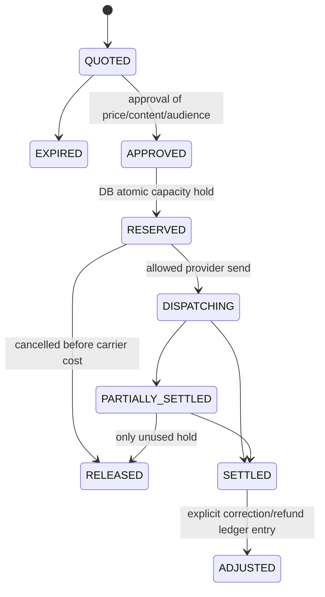

# 10 — Unified Payer, Shared Messaging Wallet, Commerce and Service Marketplace

**Commercial contract:** Group-wide payment identity pays for website subscriptions, shared messaging credits, domain/hosting/business email purchases and other approved third-party items. One shared credit wallet is used by explicitly linked independent customer/site accounts for eligible usage. Core CRM, FREE Marketing Studio, social automation, local visibility and included AI marketing work have **$0 software surcharge**. No mandatory Stripe choice. Preserve provider-neutral payment processors.

## 1. Separate three financial concepts

1. **Billing group / payer:** parent company authorized billing identity and tokenized payment methods, accounting for aggregate spend and invoices across operationally separate businesses.
2. **Wallet / usage credits:** prepaid closed-loop usage units used for eligible SMS/email/provider operations per price policy. A unit ≠ necessarily one SMS; multi-segment carrier costs/AI minutes may alter usage. Credits are not default cash equivalents.
3. **Commerce orders/subscriptions:** money-denominated website subscriptions, hosting, domain, business email, paid provider add-ons or future separately approved AI SKU. Paid via group checkout and money ledger; **do not silently withdraw SMS credits for domains/hosting**.

`BillingGroup`, `BillingGroupMembership`, `BillingProfile`, `CreditWallet`, `WalletLedgerEntry`, `CreditReservation`, `SiteSpendingPolicy` form the shared funding layer; extend existing `ServiceOrder`, `CustomerService`, marketplace catalog and billing adapter for commerce. Existing orders retain historical quoted values and legal agreements. Website subscriptions keep renewable lifecycle even if messaging wallet empty.

**WALLET-09 (2026-10-18, pending merge):** Durable Prisma wallet engine (`lib/platform/wallet/durable-service.ts`) implements posted/held/available balance from ledger + open reservations, `FOR UPDATE` wallet serialization, reservation CAS settle/release, compensating refund entries, fixture rate plans, top-up **quote only** (`WalletTopUpQuote`), and provider event receipts for future reconciliation. Migration `20261018250000_wallet09_foundation` **not applied**. All `WALLET_*` / adapter flags default **false**; live top-up mint requires `WalletFundingEvidence` (COMMERCE-11).

**COMMERCE-11:** Provider-neutral catalog, checkout, payment, subscription, invoice, and fulfillment services live in `lib/platform/commerce`. WebXXL owns product, price, order, and payment ids. Stripe, Paddle, and Lemon Squeezy adapters are unconfigured stubs. The development adapter is disabled unless `COMMERCE_PROVIDER_MODE=mock` outside production. Verified webhooks are the only payment confirmation. Credit fulfillment calls `mintCreditsFromFundingEvidence` and does not write the ledger unless `COMMERCE_WALLET_MINT_ENABLED` is set. AUTO-10 preparation jobs stay blocked while `COMMERCE_WORKFLOW_ENQUEUE_ENABLED` and the workflow flags are off. Migration `20261020120000_commerce11_foundation` is not applied. OPEN-001 included services remain unpurchasable.

## 2. Illustrative ABMED balance example

| Event | Origin account | Credits delta | Available (assuming no holds) |
|---|---|---:|---:|
| Owner tops up | ABMED group | +1,000 | 1,000 |
| Eligible SMS spend | Aesthetics | -200 | 800 |
| Eligible SMS spend | Physicians Group | -100 | 700 |
| Eligible SMS spend | Clinical Research | -50 | 650 |

Figures demonstrate **credit consumption**, not necessarily the count of recipients/sends. A multi-segment SMS or carrier surcharge could consume a different number of credits. Same wallet balance should be visible to **authorized** group/account views, with filtered account attribution.

## 3. Quote/reserve/dispatch/settle lifecycle



- Before quote: authorize actor/business/billing group; classify message and consent; estimate eligible recipients, segments and pricing version. Quote may expire.
- At approval: bind immutable campaign revision, estimated costs, destination/sender identity, recipients and cap; `reserve()` atomically holds credits with unique idempotency key.
- At dispatch: worker enumerates recipients, confirms active consent and suppression **again**, obeys caps/quiet hours, sends via correct provider, tracks external IDs.
- At settlement: only actual billable outcomes per published policy are debited; unused holds released, costs and refunds reconciled; never double-charge on duplicate status callback.
- Failed/cancelled sends: refund only unused/provider-unbilled portions according to terms, with compensating ledger entries; reconciliation identifies orphan holds.
- Group/site limits: separate monthly/day/account/channel/max-campaign caps layered on one shared wallet, not three wallets.

## 4. Concurrency and consistency guarantees

`available = posted_balance - active_reservations`; use guarded atomic DB transactions (row locks/serializable as appropriate), version checks and uniqueness per reservation and provider outcome. A simultaneous Aesthetics 200 / Physicians 100 / Clinical 50 campaign succeeds from 1,000 leaving 650 if total actual cost is those example credits. If an account tries to spend beyond group capacity, reject/queue for funds without touching sibling pending reservations. A stale view is not authoritative; group credit decision is always server-side.

Ledger is append-only and reconciled to wallet, provider bills and customer usage. Reversal/refund record references original immutable event. Store integer units, source price version, origin site/account, sender ID, campaign ID, provider and event ID. No hidden mutation of charge history when price changes.

## 5. Group membership, site count and account transfer

- One explicit BillingGroup can link multiple CustomerAccounts; one account may have many sites; each site may independently configure CRM, AI, social and SEO.
- Add/remove group membership requires approval of both authorized group owner and account owner where policy demands. Record authorization/legal basis and effective dates.
- Unlink steps: halt new wallet holds; settle or release pending reservations; freeze source attribution; preserve historical ledger and invoices; configure alternative group/new independent wallet; prevent any residual access.
- Changing payer/payment method does not change CRM, Chatwoot, sender registration or recipient consent.
- Group financial viewer may see totals by site but not necessarily named recipients or conversation content.

## 6. Unified commerce / service order lifecycle

Reuse existing marketplace `ServiceOrder`, `CustomerService` and provider-neutral `billingProvider`/`providerReference` conventions; extend with `BillingGroup` payer, quote/price snapshot, taxes, fulfillment workflow and subscription lifecycle. Proposed standard path:

```
Catalog item (FREE / Paid / 3rd-party pass-through)
  -> account/site select -> quote/version, quantity, tax and payer
  -> authorized payer approval -> checkout (selected provider)
  -> signed payment-confirmation webhook -> WebXXL Order PAID
  -> fulfillment adapter (domain, hosting, email, website, future agent)
  -> entitlement and invoice reference -> renewals, support, cancellation
```

Payments/deposits do not count as completed until provider confirmation/approved settlement. `PaymentProvider` may be Stripe/Paddle/Lemon Squeezy/other; merchant-of-record/tax considerations need owner selection. Store WebXXL-owned IDs; do not create schema with Stripe-specific required columns. Payment provider holds card data; WebXXL stores tokens and billing group mapping only.

### Purchases examples

- Aesthetics uses 200 SMS credits: decrement **ABMED shared wallet** (with proper hold/settlement).
- Physicians Group orders a domain for its site: use **ABMED group payment method**, bill money and create domain order; **no SMS credit debit** by default.
- Clinical Research website monthly subscription renews: charge **same ABMED payer**, create invoice attributed to Clinical Research; no mixing PHI with billing details.
- Future customer AI employee purchase: optional SKU/price and entitlement logic **exists in architecture only**, disabled until approved. Included receptionist/marketing agents remain part of FREE policy as defined.

## 7. Free offerings and future catalog policy

The current source marketplace quotes SEO, CRM automation and marketing as paid line items. Migration must update **forward-looking offerings**, while retaining existing historical orders/prices. Catalog capability fields include `pricingMode: INCLUDED_FREE | RECURRING | ONE_TIME | METERED_EXTERNAL`, `eligibleSubscriberCohort`, `fairUsePolicy`, `providerPassThrough`, `purchasable`, `featureFlag`. Free marketing/CRM/SEO service entitlements should not generate invoices, but may generate internal metering records. Owner must approve any future charge for previously included baseline functionality.

## 8. Accounting/tax/compliance questions (owner signoff later)

Define credit expiry/refund/transfer policy, chargebacks, stored-value legal treatment, unspent funds, tax/VAT/sales tax for subscriptions/domains, who acts as reseller or merchant of record, optional consumption of credits for nonmessaging products and emergency overdraft handling. Do not assume credits are cash, that all email volume is free or that merchant-of-record tax obligations are handled automatically.

## 9. Wallet and checkout UI

- Header shows named parent wallet and remaining credits only for authorized actor, distinct from selected project.
- Group summary: available, held, posted; site usage breakdown, month/date filter, rate version, details, refunds, purchases, invoices and permissions.
- Payer view: verified payment method tokens and invoices for all authorized sites; explicit confirmation before charge.
- FREE service cards labelled included; paid provider charges clearly separated. Historic quoted orders remain accessible.
- Insufficient wallet balance => actionable top-up quote, no silent paid SMS send.

## 10. AUTO-10 wallet safety

Workflow jobs **must not** append `WalletLedgerEntry` debits/TOP_UPs directly. Financial effects stay in **WALLET-09** domain services with existing idempotency. `WALLET_RECONCILIATION_REVIEW` is a typed handler stub only. Retries are not permission to resend billable messages or double-settle reservations.

## 11. Acceptance

- Parent group one wallet across 3 or 10 business sites; 1,000→800→700→650 example holds true for exact illustrative charge units.
- Two concurrent sending jobs cannot overspend or duplicate settlement.
- Old subscription and marketplace orders remain intact; new included CRM/SEO/marketing service costs $0 software fee.
- Group payer buys domain/hosting without consuming usage credits and with account-attributed invoice.
- Detached business cannot spend old wallet, yet historical charges remain on group reports.
- Voice/paid ad spend or AI employee SKU never charged until explicit policy and approval.
