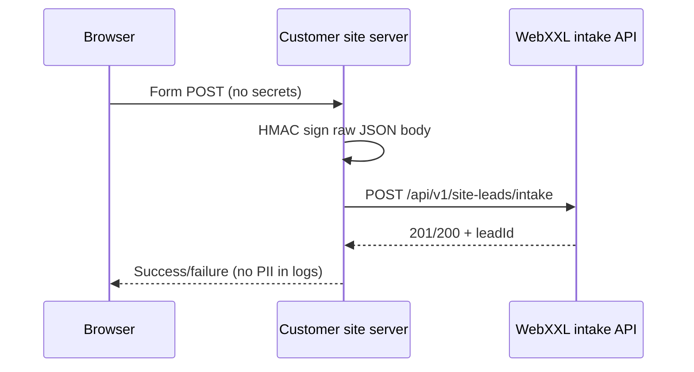

# Batch 29A — Managed-site form connector V1

**Status:** server-side connector (Cursor). **Intake API:** [`BATCH28A-MANAGED-SITE-LEADS-API-CONTRACT.md`](BATCH28A-MANAGED-SITE-LEADS-API-CONTRACT.md).  
**Activation:** connector source only in this batch — no customer site wiring, no credential provisioning, no `SITE_LEAD_INTAKE_ENABLED` change.

## Purpose

Reusable TypeScript connector for **trusted servers** on WebXXL-managed customer websites to POST contact-form leads to:

`POST /api/v1/site-leads/intake`

Implementation: `lib/platform/site-leads/connector/`.

## Architecture

- **Never** call intake from browser JavaScript with signing secrets.
- **Never** send `customerAccountId`, `managedSiteId`, or marketing consent flags.
- Tenant binding is enforced by `ManagedSiteLeadIntakeCredential` + HMAC on the WebXXL side.

## Per-site configuration

Each managed site uses one intake credential (`publicKeyId` + server secret).

| Setting | Source |
|---|---|
| Intake base URL | `WEBXXL_SITE_LEAD_INTAKE_BASE_URL` (customer server env) |
| Public key id | `WEBXXL_SITE_LEAD_INTAKE_PUBLIC_KEY_ID` |
| Signing secret | `SITE_LEAD_INTAKE_SECRET_{publicKeyId}` or custom env var via `resolveSiteLeadConnectorConfigFromEnv({ secretEnvVar })` |

Rotation: provision a new credential, deploy the new secret, revoke the old credential in WebXXL — connector picks up env changes without code changes.

## Payload

Same JSON as Batch 28A intake: `contactEmail` (required), optional name/phone/message/formReference/locale/submittedAt/fields/analyticsProvenance.

Idempotency: pass `x-idempotency-key` to the connector (or let it derive a stable SHA-256 from the exact signed raw body for retries).

## Next.js reference

See `lib/platform/site-leads/connector/reference/nextjs-server-handler.example.ts` — copy into the customer app's **server** route; do not import from WebXXL production routes.

## WordPress and custom backends

Adapter requirements (no plugin in this batch):

1. Server-side handler receives the form POST.
2. Map fields to connector payload; keep secrets in wp-config/server env only.
3. Call `submitManagedSiteLead` (or HTTP equivalent with the same headers and raw body signing).
4. Surface user-facing errors without echoing email/phone in logs.
5. Do not modify `lib/managed-sites/adapters.ts` ownership — site provisioning stays separate.

## Non-goals (29A)

- No outbound email/SMS/WhatsApp.
- No automatic CRM marketing consent.
- No duplicate intake endpoints or engines.
- No production migrations or live ABMED (or other) site publication.
