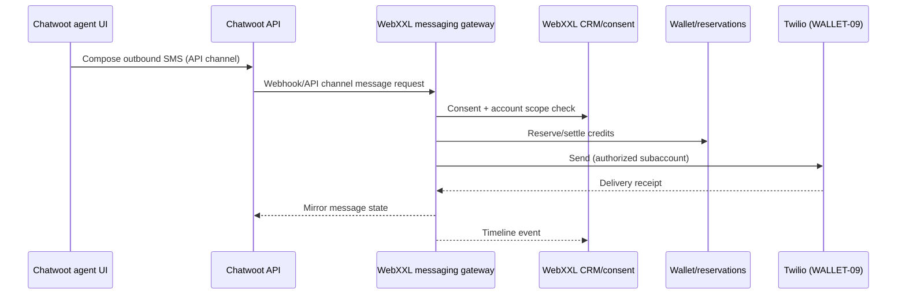

# WebXXL messaging gateway (future COMMS-06)

Chatwoot must **not** become an uncontrolled billing path to Twilio or other carriers.

## Target architecture

## Rules

- Outbound billable SMS/email only through WebXXL gateway after consent, wallet, and approval policies.
- Inbound routes map provider destination → exactly one `customerAccountId`.
- ABMED sibling accounts never share suppression lists or sender identities without explicit policy.
- No live SMS/WhatsApp/campaign configuration in INFRA-02.

## Chatwoot configuration direction

- Prefer **API Channel** and server-side integration over native Twilio channel credentials in Chatwoot.
- Store Chatwoot account/inbox IDs in WebXXL mapping table (see `chatwoot-account-mapping.ts`).
